# mpv config

[![release badge]][release] [](README.md)


Escalado limpio en cualquier pantalla — SDR, HDR, estándar o alta densidad —, subtítulos ámbar, cuatro perfiles de audio y un puñado de scripts pequeños.

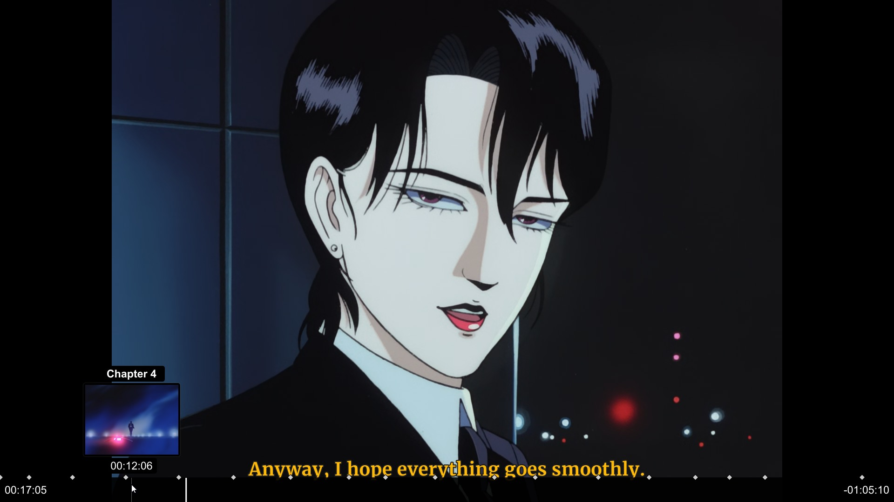
<sub>Wicked City | 1987 — Yoshiaki Kawajiri. Spoiler: no fue nada tranquilo.</sub>

## Qué incluye

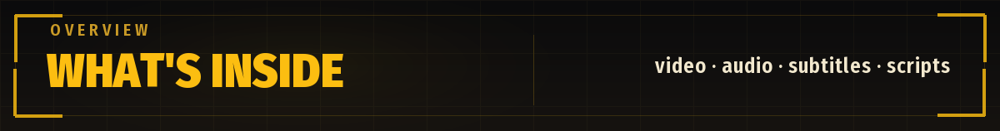

- **Vídeo** — ventana de como máximo el 90 % de la pantalla, sin bordes, con la cadena `high-quality` de abajo: `gpu-next`, EWA Lanczos, decodificación copy-back y sin interpolación de movimiento.
- **Subtítulos** — Merriweather Bold 700, incluida en [`fonts/`](fonts/) y cargada desde `~~/fonts`, así que no hay que instalar nada. El estilo se fuerza sobre todas las pistas (también los carteles ASS de fansub); los subtítulos externos se autocargan por nombre aproximado; márgenes, preroll de MKV y fuentes incrustadas activados. Se adaptan a la ventana, no al vídeo: `blend-subtitles=no` los mantiene en la capa del OSD, así que quedan nítidos a cualquier tamaño y nunca se estiran con la imagen, y `w` los mete en las barras negras de cualquier fuente con letterbox. El tamaño elegido con `+` / `-` del teclado numérico sobrevive al reinicio.
- **Audio** — downmix estéreo, corrección de tono al cambiar la velocidad, audio externo por nombre aproximado. Cuatro perfiles en `1`–`4`, arrancando en No Processing; ver [Perfiles de audio](#-perfiles-de-audio).
- **Idiomas** — subtítulos inglés (SDH comparte la etiqueta `en`) y luego español; audio inglés y luego español; se pasan a yt-dlp.
- **Streaming** — caché de 100 s, user agent de Firefox de escritorio, bitrate máximo para HLS, GIF/WebM en bucle.
- **Scripts** — `audio-norm` (perfiles), `subtitle-size` (persistencia), `esc-quit` (cierre en dos pasos), `autocrop` (recorta 10 s después de cargar; `C` lo alterna), `autodeint` (`Ctrl+d`), `autoload` (encola la carpeta), `oled-screensaver` (capa negra tras 60 s inactivo), `thumbfast` (vistas previas en la línea de tiempo).
- **Interfaz** (opcional) — [uosc](https://github.com/tomasklaen/uosc) instalado desde su última release por el instalador de cada sistema ([paso 3](#-instalación)): línea de tiempo por proximidad, barra de control, menús con búsqueda para pistas, búsqueda en OpenSubtitles ([privacidad y seguridad](#-privacidad-y-seguridad)), lista de reproducción, capítulos, explorador de archivos y consulta de keybindings, todo con vistas previas de thumbfast. Sigue a `osd-font` y al orden de idiomas de subtítulos; el deslizador de volumen refleja las teclas del numérico (pon `volume=none` en `script-opts/uosc.conf` para ocultarlo). Sin uosc toma el control el OSC mínimo de `script-opts/osc.conf`.
- **Miniaturas** — [thumbfast](https://github.com/po5/thumbfast) (MPL-2.0) viene en `scripts/` y genera las vistas previas ejecutando mpv desde `PATH`. Si mpv no está en `PATH` (habitual en Windows), apúntalo en `script-opts/thumbfast.conf` (gitignored):

  ```ini
  mpv_path=C:\Program Files\mpv\mpv.exe
  ```

### Cómo se muestra el vídeo

`high-quality` es la cadena completa. Solo remuestrea cuando el fotograma y la ventana no coinciden, y estos son los valores por defecto para cualquier archivo.

| Etapa | Ajuste | Efecto |
| --- | --- | --- |
| Salida | `gpu-next` (por defecto en 0.40+), `gpu-context=auto`, Vulkan asíncrono, una cola | libplacebo en la GPU |
| Decodificación | `hwdec=auto-copy` | Decodifica en la GPU y copia los fotogramas de vuelta, así `idet`/`cropdetect` funcionan |
| Escalado | `scale=ewa_lanczossharp`, `scale-radius=2`, `scale-antiring=1` | EWA Lanczos realzado, radio contenido, antiringing |
| Reducción | `dscale=ewa_lanczossharp`, `correct-downscaling` | El mismo kernel, filtrado en luz lineal: sin aliasing |
| Croma | `cscale=ewa_lanczos`, `cscale-antiring=1` | Croma 4:2:0 limpio; `ewa_lanczossoft` solo existe en `vo=gpu` |
| Política | `scaler-resizes-only` | Nada de remuestreo cuando la ventana ya coincide con el fotograma |
| Luz | `sigmoid-upscaling` | Escala en luz lineal: sin halos oscuros ni altas luces lavadas |
| Dither | `temporal-dither`, `dither-depth=auto` | El redondeo sigue la profundidad real de la pantalla, así los degradados no hacen bandas |
| Rango | `video-output-levels=full` | RGB de rango completo a la pantalla |
| HDR | `hdr-compute-peak=yes`, `target-colorspace-hint=yes` | Tone mapping sobre el pico medido y colorspace real a la pantalla |
| Deband | `deband=no`; `b` lo alterna | Ajustado (4 iteraciones, umbral 48, rango 16, grano 48), apagado |
| Sincronía | `video-sync=audio`, `opengl-swapinterval=1` | El reloj de audio manda, sin interpolación; swap interval 1 en contextos GL |
| Ventana | `autofit-larger=90%x90%`, `no-border` | Como máximo el 90 % de la pantalla, sin bordes |

Los subtítulos no pasan por esta cadena: `blend-subtitles=no` los dibuja en la capa del OSD a la resolución de la ventana. El debanding sigue apagado porque cuesta GPU y emborrona el grano, y `b` es el único interruptor.

## 🎚 Perfiles de audio

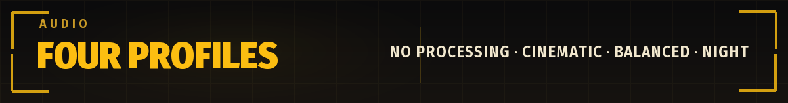

`scripts/audio-norm.lua` es dueño de la cadena de filtros. Cada tecla la **reemplaza**, y la reproducción arranca en **1 — No Processing**. Las asignaciones llaman a keybindings con nombre del script, así que se pueden remapear sin tocar el Lua.

| Tecla | Perfil | Cadena | I (LUFS) | LRA | TP (dBTP) | Carácter |
| --- | --- | --- | ---: | ---: | ---: | --- |
| `1` | No Processing (por defecto) | ninguna | — | — | — | mezcla original |
| `2` | Cinematic | `loudnorm` | −23 | 18 | −1 | amplio, natural |
| `3` | Balanced | `loudnorm` | −18 | 15 | −2 | controlado |
| `4` | Night Mode | `acompressor` 4:1 a −18 dB → `loudnorm` | −16 | 7 | −3 | diálogo realzado |

Cinematic, Balanced y Night Mode usan `loudnorm` en modo dinámico de una pasada (`linear=false`): la ganancia sigue al objetivo en vivo, sin pre-escaneo. Night Mode añade una etapa de compresor — umbral `0.125` (≈ −18 dBFS), ratio `4:1`, ataque `20 ms`, liberación `250 ms`, knee `2.5`, sin ganancia de compensación. Todos los perfiles procesados terminan en `alimiter` (`level=0`, ataque 5 ms / liberación 50 ms): el TP de `loudnorm` es el objetivo de pico real, y `alimiter` la red de seguridad de pico de muestra.

- **LUFS** — sonoridad percibida; `loudnorm` lleva la ganancia al objetivo y limita LRA y TP.
- **Sonoridad ≠ volumen** — la sonoridad es de la grabación; el volumen, del reproductor, el sistema, el DAC o los altavoces.
- **Normalización dinámica** — ajusta mientras suena; sin pre-escaneo, así que el resultado depende de la fuente.
- **Compresión** — `acompressor` baja lo que supera su umbral y reduce la distancia entre diálogo y efectos.
- **LRA** — el rango de silencioso a fuerte; un objetivo menor lo comprime más. Las etiquetas describen el resultado buscado, no una medición de cada banda sonora.

**El volumen** arranca en 100. El teclado numérico `0`–`9` pone 0 %, 11.1 %, …, 88.9 %, 100 % (0 es silencio, 9 es escala completa); `/` y `*` ajustan ±2; `m` y la tecla de silencio silencian. `volume-max=100` impide ganancia por encima de 100 %, y el `9`/`0` horizontal, `/`, `*`, la rueda normal y las teclas multimedia de volumen siguen sin asignar (`Ctrl`+rueda es zoom).

**Reanudar** restaura solo la posición: `watch-later-options-remove` quita `af`, `volume` y `mute` de los archivos watch-later nuevos, y el perfil se reafirma en cada carga. Los watch-later antiguos pueden seguir trayendo un volumen; borrarlos lo limpia.

## 🎨 Diseño


**El color.** `#FCBE11` es el amarillo de subtítulos que recuerdo del cine y de la tele de casa: cálido, familiar, un poco nostálgico. Sobre escenas oscuras cansa menos que el blanco puro y deslumbra menos en una película de dos horas.

**Merriweather Bold.** Una serif de pantalla con altura de x grande y bajo contraste de trazo, así que las minúsculas se mantienen sólidas al tamaño del subtítulo y aguantan ClearType. Bold 700 lleva un contorno *fino* en lugar del borde negro grueso habitual y conserva la forma sobre imagen cargada, donde serifs más aireadas como Source Serif o IBM Plex Serif pierden detalle. [Más sobre la fuente](https://fontfyi.com/blog/source-serif-vs-merriweather/).

Estilo del subtítulo: relleno `#FCBE11` · contorno `#1F1F1F` a 1.5 · tamaño 40 · espaciado 0.5 · sombra `#33000000` (ARGB, 20 % negro) a 1 px.

## 💬 Subtítulos: colocación adaptable

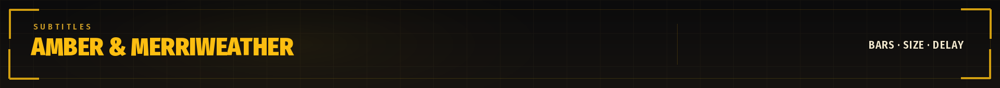

Los subtítulos se colocan contra la ventana en lugar de contra la imagen: `blend-subtitles=no` los mantiene en la capa del OSD, así que quedan nítidos a cualquier tamaño de ventana y nunca se estiran con la imagen. `sub-use-margins=yes` y `sub-ass-force-margins=yes` les permiten usar todo el marco, y `w` los mueve a la barra negra inferior de cualquier fuente con letterbox — 21:9 o 4:3, mismo comportamiento. `sub-pos` va de 0 a 150; 100 es el sitio normal justo por encima del borde inferior, y `w` (o ~100–106) queda dentro de la barra. Mucho más arriba se acerca al borde de la ventana y puede recortarse, sobre todo con dos líneas.

El teclado numérico `+` / `-` cambia el tamaño; `scripts/subtitle-size.lua` escribe cada cambio en `subtitle-size.txt` y lo restaura al arrancar. El archivo está en gitignore — bórralo para volver a `sub-font-size=40`.

## Keybindings

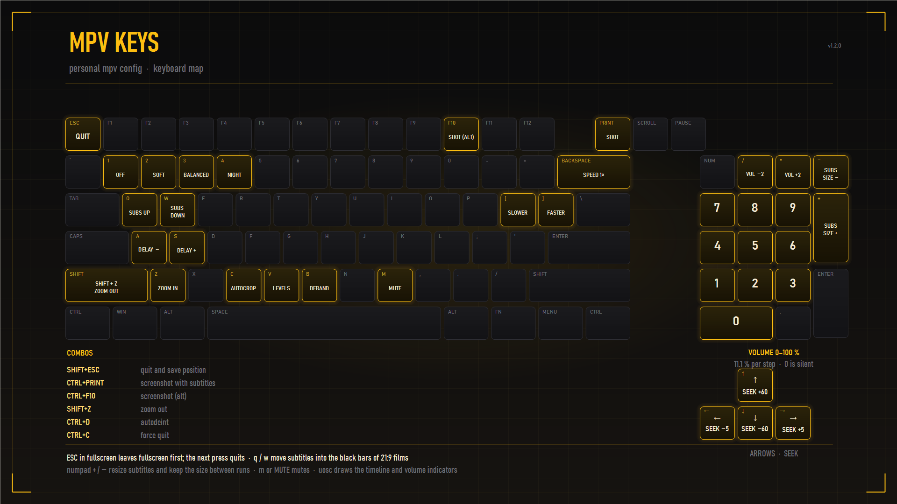

| Tecla | Acción |
| --- | --- |
| `1` / `2` / `3` / `4` | Perfil de audio: No Processing / Cinematic / Balanced / Night Mode |
| `m` | Silenciar † |
| `Space` | Pausa / reanudar (valor por defecto de mpv) |
| `q` / `w` | Subtítulos arriba / abajo (pasado el 100 % entran en las barras negras) |
| `a` / `s` | Retardo de subtítulos −100 ms / +100 ms |
| `Ctrl`+rueda arriba/abajo | Zoom in / out (`video-zoom`) |
| `Ctrl`+arrastrar | Desplazar la imagen ampliada |
| `F10` / `Shift+F10` | Captura sin / con subtítulos |
| `Esc` | Salir de pantalla completa; en ventana, cerrar (antes se cierra un menú de uosc) |
| `Shift+Esc` | Cerrar y guardar la posición |
| `b` | Alternar deband |
| `←` / `→` | Saltar −5 s / +5 s † |
| `↑` / `↓` | Saltar +60 s / −60 s † |
| `[` / `]` | Bajar / subir velocidad (×0.91 / ×1.1) † |
| `Backspace` | Volver a velocidad 1× † |
| numérico `0`–`9` | Volumen 0 %, 11.1 %, …, 88.9 %, 100 % † |
| numérico `+` / `-` | Tamaño de subtítulo ±2 (se guarda entre ejecuciones) |
| `C` | Autocrop ahora (también corre 10 s después de empezar la reproducción) |
| `Ctrl+d` | Autodeint |

† Muestra el indicador propio de uosc (línea de tiempo, volumen o velocidad) en lugar de la barra OSD integrada.

`f` (pantalla completa) y las teclas habituales de pista y lista son valores por defecto de mpv. Sin asignar a propósito: `r`, `t`, `e`, `x`, `z`, `Shift+z`, `v`, `Shift+q`, `5`–`8`, el `9`/`0` horizontal, `/`, `*`, rueda arriba/abajo/izquierda/derecha, `S`, `Ctrl+s`, `Alt+s`, `Ctrl+w`, `u`, `V`, `A`, `F`, `G`, `E`, `PrintScreen` y las teclas multimedia de volumen. Solo `1`–`4` son teclas numéricas horizontales; los dígitos del teclado numérico ponen el volumen. `q` ya no cierra: `Esc` y `Shift+Esc` son las teclas de salida (`Ctrl+c` sigue forzando el cierre).

**Cerrar** es en dos pasos a propósito. En pantalla completa, `Esc` sale de pantalla completa y solo la siguiente pulsación cierra. `Shift+Esc` siempre cierra y guarda la posición; el botón de cerrar la ventana también guarda (`save-position-on-quit`). El reanudado conserva la posición, no el perfil de audio: el script reafirma el perfil elegido al cargar.

**Capturas** — `F10` captura el fotograma y `Shift+F10` añade los subtítulos. Salida PNG; con `blend-subtitles=no` ninguno de los dos modos incluye las barras negras. Las antiguas asignaciones `s`/`S`/`Ctrl+s`/`Alt+s` y `PrintScreen` ya no están, para que `s` ajuste el retardo de subtítulos y la tecla Impr Pant quede para el sistema.

**Zoom** — `Ctrl`+rueda mueve `video-zoom`: 0 es ajustar, 0.1 es aproximadamente +7 % y los valores negativos alejan más allá del marco. `Alt+Backspace` reinicia zoom, desplazamiento y alineación. `z`/`Shift+z` ya no tocan la imagen.

**Autocrop** — a los 10 s de reproducción detecta los bordes negros codificados y los recorta; `C` aplica o deshace el recorte en cualquier momento.

## 📥 Instalación

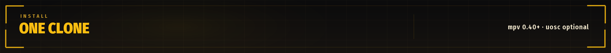

Requiere **mpv 0.40+** (`gpu-next`; probado en 0.41 y 0.42). El repositorio *es* la carpeta de configuración, así que instalar es un solo clone. **¿Ya usas esta configuración?** No clones otra vez — ve a [Actualizar](#-actualizar).

**1 — Clonar.** Elige tu sistema; el renombrado deja una configuración antigua como `mpv.backup` y no hace nada si no hay ninguna. Git es la única herramienta necesaria — en Windows, instala primero [git-scm.com](https://git-scm.com/downloads).

Windows (PowerShell):

```console
if (Test-Path "$env:APPDATA\mpv") { Move-Item "$env:APPDATA\mpv" "$env:APPDATA\mpv.backup" }
git clone https://github.com/mfascioli/mpv-config.git "$env:APPDATA\mpv"
```

Linux / macOS:

```console
mv ~/.config/mpv ~/.config/mpv.backup 2>/dev/null
git clone https://github.com/mfascioli/mpv-config.git ~/.config/mpv
```

**2 — Abrir mpv.** Ajustes, keybindings, scripts, la fuente Merriweather y un OSC mínimo ya están listos. mpv encuentra la carpeta solo — sin flags, sin red.

**3 — Opcional: uosc.** La línea de tiempo, la barra de control, los menús y la búsqueda. Ejecuta un comando; sáltalo para quedarte con el OSC mínimo:

```console
powershell -ExecutionPolicy Bypass -File "$env:APPDATA\mpv\install-uosc.ps1"   # Windows 10/11
bash ~/.config/mpv/install-uosc-ubuntu.sh                                      # Ubuntu / Debian
bash ~/.config/mpv/install-uosc-cachyos.sh                                     # CachyOS / Arch
bash ~/.config/mpv/install-uosc-macos.sh                                       # macOS
```

El instalador es nativo de cada sistema, baja la última release de uosc por HTTPS, verifica el SHA-256 de GitHub y conserva un `script-opts/uosc.conf` existente. Linux necesita `curl`/`wget` y `unzip`/`bsdtar`, y pregunta antes de instalar un paquete que falte (`--yes` / `-y` salta la pregunta); `--no-verify` salta la suma de comprobación. Todo lo que instala está en gitignore, así que las actualizaciones nunca sobrescriben uosc, y cada instalador de Linux se niega a correr en la distro equivocada. ¿La carpeta de configuración está en otro sitio? Añade `-ConfigDir <ruta>` / `--config-dir <ruta>`.

### 🔄 Actualizar

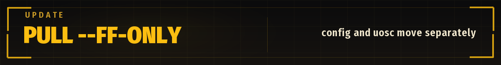

Dos piezas independientes — actualízalas por separado.

**La configuración.** Un comando, sin abrir la carpeta:

```console
git -C "$env:APPDATA\mpv" pull --ff-only   # Windows
git -C ~/.config/mpv pull --ff-only        # Linux / macOS
```

Los archivos que añadas y los `script-opts/*.conf` en gitignore quedan intactos. Tus ediciones en archivos versionados bloquean el pull: muévelas a un lado o usa `git stash` antes.

**uosc.** Vuelve a ejecutar su instalador, el mismo comando del paso 3. Reemplaza solo uosc y conserva `uosc.conf`.

La opción **Utils → Update uosc** de uosc también funciona, pero canaliza el instalador de `master` a una shell (`irm … | iex`, `source <(curl …)`); el instalador de arriba descarga una release y valida su estructura primero.

### 🗑 Desinstalar uosc

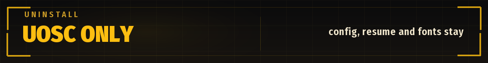

```console
powershell -ExecutionPolicy Bypass -File "$env:APPDATA\mpv\uninstall-uosc.ps1"   # Windows
bash ~/.config/mpv/uninstall-uosc.sh                                            # Linux / macOS
```

Quita `scripts/uosc/`, los dos archivos `fonts/uosc_*` y `script-opts/uosc.conf`, y deja el resto intacto; `-KeepConf` / `--keep-conf` conserva tus preferencias. El OSC integrado toma el control de inmediato. Para quitar la configuración misma, borra su carpeta — tus archivos antiguos siguen en `mpv.backup`.

Las notas de versión están en [CHANGELOG.md](CHANGELOG.md) (en inglés).

## 🔒 Privacidad y seguridad

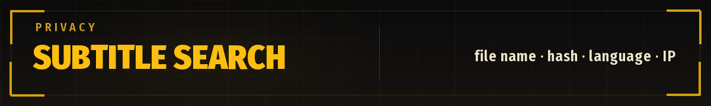

**Cómo se escribió.** La mayor parte del código — `mpv.conf`, `input.conf`, `scripts/`, los instaladores y esta documentación — se generó con **DeepSeek V4.1 Flash Free** en OpenCode y después se revisó con **Claude Sonnet 5.5** y **GPT-6 Luna**. Los archivos de la 1.3.0 también se analizaron con VirusTotal y otras herramientas antes de publicarlos.

La búsqueda de subtítulos dentro de uosc es una llamada a un tercero, no una función local. Una búsqueda envía a **OpenSubtitles** el nombre del archivo de vídeo sin extensión, el hash del archivo cuando está disponible, los idiomas y la página que pediste y tu dirección IP; descargar un subtítulo también envía su id. Las peticiones salen de `ziggy`, el binario auxiliar que viene con uosc.

Revisé el código publicado — `menus.lua` y `main.lua` para la interfaz de búsqueda, y `subtitles.go`, `utils.go` y `http.go` de `ziggy` — y no encontré analítica, píxeles de seguimiento ni telemetría publicitaria en esta función.

Esa auditoría cubre código publicado, no tráfico real: no puede mostrar qué hace OpenSubtitles con los datos ni descartar cambios en una versión posterior. Un nombre de archivo sigue diciendo lo que estás viendo. Si eso te importa, sáltate el descargador integrado y busca subtítulos en otra fuente — el resto de uosc funciona sin él.

La revisión completa — procedencia, garantías de los instaladores, qué se corrigió y qué no puede demostrar — está en [SECURITY.md](SECURITY.md).

## 🙏 Créditos

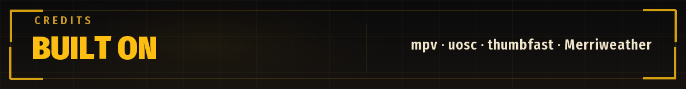

El reproductor es [mpv](https://mpv.io/), del [proyecto mpv](https://github.com/mpv-player/mpv) (GPL-2.0+); este repositorio solo lo configura. Es un fork de [wopian/mpv-config](https://github.com/wopian/mpv-config). Interfaz por [uosc](https://github.com/tomasklaen/uosc) (LGPL-2.1); miniaturas por [thumbfast](https://github.com/po5/thumbfast) (MPL-2.0); Merriweather bajo SIL OFL (ver [`Merriweather-OFL.txt`](Merriweather-OFL.txt)).

## 💡 También te puede interesar

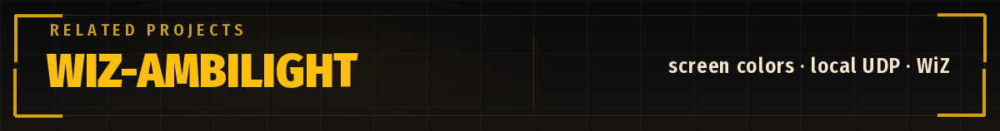

[wiz-ambilight](https://github.com/mfascioli/wiz-ambilight) (MIT) lleva los bordes de la imagen de mpv a bombillas WiZ por la red local: un script Lua muestrea el fotograma, un bucle de fundido mueve las bombillas a 18 Hz y su panel toma la paleta ámbar de esta configuración. Sin capturadora, sin nube y sin paquetes de Python.

[release]:https://github.com/mfascioli/mpv-config/releases
[release badge]:https://flat.badgen.net/github/release/mfascioli/mpv-config
