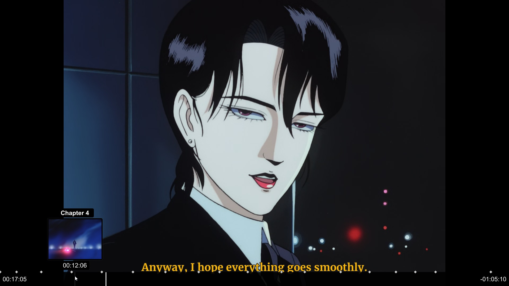

# mpv config

[![release badge]][release]

A personal mpv setup meant to look right on any screen — SDR or HDR, standard or high DPI — and for any viewer: clean scaling, subtitles in the amber tone of classic cinema/TV, stereo audio with optional loudness profiles and a few small quality-of-life scripts.


<sub>Wicked City | 1987 - film by Yoshiaki Kawajiri<br>
Spoiler: it did not go smoothly at all.</sub>


## What's inside

**Video** — starts windowed, capped at 90 % of the screen, borderless with rounded corners. The `high-quality` profile is on by default: EWA Lanczos scaling with antiringing, sigmoid upscaling, correct downscaling, temporal dither, full-range output and HDR peak computation. Motion interpolation and hardware decoding are off by default; debanding is off too (`b` toggles it).

**Subtitles** — Merriweather Bold (700), bundled in [`fonts/`](fonts/) and loaded from `~~/fonts`, so nothing has to be installed. Styling is forced over every track (including ASS/fansub signs); external subs autoload fuzzily, and margins, MKV preroll and embedded fonts are enabled. Subtitles stay on their own layer (`blend-subtitles=no`), so they can sit in the black bars of a 21:9 film on a 16:9 screen: press `w` until they reach the bottom bar. The size chosen with numpad `+` / `-` is written to `subtitle-size.txt` and restored on the next launch. The with-subtitles screenshot includes them; the video-only mode excludes them.

| Property | Value |
| --- | --- |
| Fill | `#FCBE11` (amber) |
| Outline | `#1F1F1F`, 1.5 (thin) |
| Size | 40 |
| Spacing | 0.5 |
| Shadow | `#33000000`, 1 px |

**Audio** — stereo downmix (`audio-channels=stereo`), pitch correction when changing speed, fuzzy external audio. `scripts/audio-norm.lua` provides three processing profiles plus a bypass on `1`–`4`. Playback starts in Off (1), so the original mix plays untouched until a profile is chosen:

| Key | Profile | Target | Gain | Compression | Peak | Dynamics |
| --- | --- | --- | --- | --- | --- | --- |
| `1` | Off (No Filters), default | — | Off | Off | — | Original |
| `2` | Soft | −22 LUFS | Automatic | Off | −1.5 dBFS | Wide, LRA 18 |
| `3` | Balanced | −20 LUFS | Automatic | Off | −2 dBFS | Moderate, LRA 14 |
| `4` | Night | −18 LUFS | Automatic | Strong, 4:1 at −18 dB | −3 dBFS | Reduced, LRA 7 |

| | Off | Soft | Balanced | Night |
| --- | --- | --- | --- | --- |
| Dynamics | Original | Wide | Moderate | Reduced |
| Dialogue | Original | More consistent | More even | Lifted |
| Explosions | Full impact | Mostly preserved | Controlled | Strongly controlled |
| Use | Reference / bypass | Quiet listening | PC / headphones | Late night |

Off leaves the mix alone. Soft and Balanced apply only FFmpeg's `loudnorm` in single-pass dynamic mode (`linear=false`), so gain follows the target without a pre-scan; Night adds a 4:1 compressor at −18 dB before normalizing to −18 LUFS. Every processed profile ends in `alimiter` at its peak ceiling. Volume starts at 100 and numpad `0`–`9` sets it from 0 % to 100 %; `m` (or the keyboard's mute key) mutes. See [Audio profiles and loudness](#audio-profiles-and-loudness) for the parameters and the reasoning.

**Languages** — subtitles English (SDH tracks share the same `en` tag) and then Spanish; audio English first, Spanish second. Subtitle languages are forwarded to yt-dlp.

**Streaming** — 100 s cache and a desktop Firefox user agent over HTTP/HTTPS, maximum HLS bitrate, GIFs and WebM loop.

**Keys** — the bindings this config adds or changes:

| Key | Action |
| --- | --- |
| `1` / `2` / `3` / `4` | Audio profile: off / soft / balanced / night |
| `m` | Mute † |
| `q` / `w` | Subtitles up / down (past 100 % they enter the black bars) |
| `a` / `s` | Subtitle delay −100 ms / +100 ms |
| `z` / `Shift+z` | Zoom (panscan) more / less |
| `PrintScreen` / `Ctrl+PrintScreen` | Screenshot without / with subtitles |
| `F10` / `Ctrl+F10` | Same, when the OS captures PrintScreen |
| `Esc` | Leave fullscreen; when windowed, quit (a uosc menu closes first) |
| `Shift+Esc` | Quit and save the position |
| `b` / `v` | Toggle deband / cycle video output levels |
| `←` / `→` | Seek −5 s / +5 s † |
| `↑` / `↓` | Seek +60 s / −60 s † |
| `[` / `]` | Speed down / up (×0.91 / ×1.1) † |
| `Backspace` | Speed back to 1× † |
| numpad `0`–`9` | Volume 0 % / 11 % / … / 89 % / 100 % † |
| numpad `+` / `-` | Subtitle size ±2 (saved between runs) |
| `C` / `Ctrl+d` | Autocrop / autodeint |

† Flashes uosc's own timeline, volume or speed indicator instead of the built-in OSD bar.

`f` (fullscreen), `Space` (pause), double-click (fullscreen), the seek keys and the usual track/playlist bindings remain mpv defaults. Deliberately unbound: `r`, `t`, `e`, `x`, `Shift+q`, `5`–`8`, `9`, `0`, `/`, `*`, mouse wheel up/down (`WHEEL_UP`, `WHEEL_DOWN`), `S`, `Ctrl+s`, `Alt+s`, `Ctrl+w`, and the volume-up/down media keys. Only `1`–`4` are used as horizontal number keys; the numpad digits set volume. `q` no longer quits; `Esc` and `Shift+Esc` are the normal quit keys (`Ctrl+c` remains as an emergency force-quit).

`Esc` is a two-step close on purpose: in fullscreen it leaves fullscreen, and only the next press quits. `Shift+Esc` always quits and saves the position; the window close button also saves because `save-position-on-quit` is enabled. The saved resume state contains the position, not the audio profile: the script reasserts the selected profile when the file loads (see [Audio profiles and loudness](#audio-profiles-and-loudness)).

**Screenshots** — `PrintScreen` saves the current frame without subtitles and `Ctrl+PrintScreen` with them; `F10` / `Ctrl+F10` do the same where the OS reserves PrintScreen. On Windows 11, turn off *Settings → Accessibility → Keyboard → Use the Print Screen key to open Snipping Tool* if PrintScreen never reaches mpv. Files are PNG (`screenshot-format=png`). Because `blend-subtitles=no`, `screenshot video` captures the frame alone and `screenshot subtitles` captures the frame plus subtitles; neither includes the letterbox bars. The old `s`, `S`, `Ctrl+s` and `Alt+s` screenshot bindings are gone so `s` can adjust subtitle delay.

**Scripts** — `audio-norm` (the four audio profiles), `subtitle-size` (remembers the subtitle size), `esc-quit` (two-step Esc close), `autocrop` (black bars, `C` manual), `autodeint` (`Ctrl+d`), `autoload` (queue the folder), `oled-screensaver` (black overlay after 60 s idle), `thumbfast` (timeline thumbnails for uosc).

**Interface** — [uosc](https://github.com/tomasklaen/uosc), installed from its latest official release by the per-system installer (`install-uosc.ps1` on Windows, `install-uosc-ubuntu.sh`, `install-uosc-cachyos.sh` or `install-uosc-macos.sh`): a proximity-based timeline and control bar plus searchable menus for audio/subtitle tracks, subtitle search on OpenSubtitles, playlist, chapters, file browser and keybind lookup, with live timeline thumbnails from [thumbfast](https://github.com/po5/thumbfast). It follows `osd-font` (the system sans-serif) and the `slang` order above. The built-in OSD bar is off and the config is borderless, so uosc draws its own border, window controls and progress indicators. Its volume slider shows the same level as the numpad keys; set `volume=none` in `script-opts/uosc.conf` (generated by the uosc installer and not tracked here) if you prefer no slider. The old minimal OSC (`script-opts/osc.conf`) stays as a fallback if uosc is removed.

**Thumbnails** — [thumbfast](https://github.com/po5/thumbfast) (MPL-2.0) ships in `scripts/`, so hovering uosc's timeline shows a live preview with nothing else to install. It renders them by running mpv in the background, which it looks up in `PATH`. If mpv is not in `PATH` (common on Windows), tell it where mpv is in `script-opts/thumbfast.conf`:

```ini
# script-opts/thumbfast.conf — only needed when mpv is not in PATH
mpv_path=C:\Program Files\mpv\mpv.exe
```

That file is listed in `.gitignore`, so the absolute path stays local. Without uosc, thumbfast simply does nothing.

## Audio profiles and loudness

`scripts/audio-norm.lua` owns the audio-filter chain. Each key replaces the chain instead of stacking filters, and playback starts in **1 — Off**; press **2**, **3** or **4** to process. The keys live in `input.conf` and call named script bindings, so they can be remapped without editing the Lua file.

| Key | Profile | Processing | I (LUFS) | LRA | TP (dBTP) | Peak limiter |
| --- | --- | --- | ---: | ---: | ---: | ---: |
| `1` | Off (No Filters), default | No filters | — | — | — | — |
| `2` | Soft | `loudnorm` only | −22 | 18 | −1.5 | −1.5 dBFS |
| `3` | Balanced | `loudnorm` only | −20 | 14 | −2 | −2 dBFS |
| `4` | Night | `acompressor` 4:1 at −18 dB → `loudnorm` | −18 | 7 | −3 | −3 dBFS |

`I` is the integrated-loudness target, `LRA` the target loudness range, `TP` the maximum true peak, and the final column the sample-peak ceiling of `alimiter`. Soft, Balanced and Night pass `linear=false` explicitly, selecting `loudnorm`ʼs dynamic mode; the filter adjusts gain as it plays instead of relying on a two-pass, file-measured correction. Soft and Balanced are normalization only. Night adds one compressor stage, threshold `0.125` (≈ −18 dBFS), ratio `4:1`, attack `20 ms`, release `250 ms`, knee `2.5` and unity makeup gain.

`alimiter` runs with automatic level compensation disabled (`level=0`) and its default 5 ms attack / 50 ms release. Its ceiling is a sample-peak safety net; `loudnorm`ʼs `TP` target is the true-peak target. They are related but not the same measurement.

| Characteristic | Off | Soft | Balanced | Night |
| --- | --- | --- | --- | --- |
| Dynamic range | Original / widest | Wide | Moderate | Reduced |
| Dialogue | Original mix | More consistent | More even | Lifted |
| Loud effects | Full impact | Mostly preserved | Controlled | Strongly controlled |
| Suggested use | Reference / bypass | Quiet listening | PC / headphones | Late night / low volume |

**What the processing does**

- **LUFS / loudness:** a standardized measure of perceived programme loudness. `loudnorm` adjusts gain toward the selected integrated target and constrains loudness range and true peaks.
- **Loudness versus volume:** loudness is a property of the recording; volume is the output level of the player, OS, DAC, amplifier or speakers. Normalizing films makes their perceived level more consistent; it does not decide how loud the speakers play.
- **Dynamic normalization:** single-pass `loudnorm` keeps adjusting gain while the file plays. It reduces level swings without a pre-scan, but the result depends on the source.
- **Compression:** `acompressor` turns down signal above its threshold. More compression reduces the contrast between quiet dialogue and loud effects, which helps at low volume.
- **Limiting:** `loudnorm`ʼs `TP` target constrains true peaks; the final `alimiter` catches sample peaks. A limiter is not a substitute for the loudness target.
- **Dynamic range / LRA:** the difference between quiet and loud passages. A lower LRA target compresses that difference more. The qualitative labels are the intended listening result; LRA is a filter target, not a measurement of every soundtrack.

The LUFS targets make different films and episodes similarly loud, but they do not set the final listening level. Volume starts at 100; numpad `0`–`9` sets it to 0 %, 11.1 %, …, 88.9 %, 100 % (0 is silent, 9 is full scale), and numpad `+` / `-` change the subtitle size instead. The horizontal `9` / `0`, `/`, `*`, mouse wheel and multimedia volume keys stay unbound, and `volume-max=100` prevents gain above 100 %. `m` and the keyboard's mute key still mute.

Resuming a file restores its position. The audio profile is a session choice, not part of the resume state: `watch-later-options-remove` drops `af`, `volume` and `mute` from new watch-later files, and the audio script reasserts the selected profile whenever a file loads. Old watch-later files created before 1.2.0 may still contain `af` or a volume; the profile is reasserted on load, and deleting those files removes any stale volume.

### Subtitles: black bars and size

`blend-subtitles=no` keeps subtitles on their own layer, outside the video image. That is what lets them sit in the letterbox bars: a 21:9 film on a 16:9 screen has bars below the picture, and `sub-use-margins=yes` plus `sub-ass-force-margins=yes` (both already set) allow the text there. `sub-pos` runs from 0 to 150; 100 is the normal position, which is usually just above the bottom edge. Press `w` (or set `sub-pos` around 100–106) to move the text into the bottom bar. Values much above that approach the window edge and can clip, especially with two lines.

The subtitle size chosen with numpad `+` / `-` (or mpvʼs `G` / `F`) is saved to `subtitle-size.txt` in the config directory on every change and restored at startup. That file is gitignored; delete it to return to `sub-font-size=40` from `mpv.conf`.

## Installation

Requires **mpv 0.40 or newer** (the config targets `gpu-next`, the default video output since 0.40; tested on 0.41). Both options start by cloning this repo into your mpv config directory — `%APPDATA%\mpv` on Windows, `~/.config/mpv` on Linux/macOS:

```console
# Windows
cd /d "%APPDATA%\mpv" && git init . && git remote add -t * -f origin https://github.com/mfascioli/mpv-config && git checkout master

# Linux / macOS
cd ~/.config/mpv && git init . && git remote add -t \* -f origin https://github.com/mfascioli/mpv-config && git checkout master
```

### Option 1 — config only

Nothing else to do: player settings, keybinds, Lua scripts, the bundled Merriweather and the minimal bottom-bar OSC in `script-opts/osc.conf`. Launch mpv and it just works, with no network access after cloning.

### Option 2 — config + uosc

Run the installer **after** cloning, from the config directory:

```console
# Windows 10/11 (PowerShell 5.1+)
powershell -ExecutionPolicy Bypass -File .\install-uosc.ps1

# Ubuntu / Debian
bash install-uosc-ubuntu.sh

# CachyOS / Arch
bash install-uosc-cachyos.sh

# macOS
bash install-uosc-macos.sh
```

Each script is native to its system and uses only what is already there:

| System | Downloads with | Extracts with | If a tool is missing |
| --- | --- | --- | --- |
| Windows | `Invoke-WebRequest` | `Expand-Archive` | nothing to install (PowerShell only) |
| Ubuntu / Debian | `curl`, else `wget` | `unzip` | asks, then `sudo apt-get install` of that package only; `--yes` skips the question |
| CachyOS / Arch | `curl` (in base) | `bsdtar` (libarchive, in base) | asks, then `yay` / `paru` / `pacman -S --needed` of that package only; `--yes` skips the question |
| macOS | `curl` (built in) | `unzip` (built in) | stops and says what is missing; installs nothing |

The two Linux scripts refuse to run on the wrong distribution and point to the right one, so nothing is ever installed just to satisfy the wrong OS.

uosc is **not vendored in this repo**: the script downloads it straight from the latest official release at the moment you run it, so you always get the current version instead of a copy frozen in a tag. Option 2 is Option 1 plus the interface; nothing else changes.

What the script does:

- Downloads `uosc.zip` at run time from `github.com/tomasklaen/uosc/releases/latest` over HTTPS — nothing is copied from this repo. Downloads are HTTPS-only, with timeouts and a size cap.
- Verifies the SHA-256 that GitHub publishes for `uosc.zip` (and for `uosc.conf` when it installs one) before extracting or replacing anything — it catches a corrupted download or a tampered CDN, not a compromised upstream release. If the API is unreachable or rate-limited, it stops instead of installing unverified code; `-NoVerify` / `--no-verify` skips the check.
- Checks the archive layout **before** removing an existing uosc, so a broken release cannot leave you without an interface.
- Installs `scripts/uosc/` and its icon font (`fonts/uosc_icons.otf`, `fonts/uosc_textures.ttf`), plus the LGPL-2.1 license next to the code.
- Downloads `script-opts/uosc.conf` (all options with their defaults) **only if you do not have one**; existing settings are kept.
- Leaves `mpv.conf`, `input.conf`, the other scripts and Merriweather untouched.
- Accepts `-ConfigDir <path>` / `--config-dir <path>` to install into another config directory, `-Force` / `--force` to replace `uosc.conf` with the defaults, `-NoVerify` / `--no-verify` to skip the SHA-256 check, and `-y` / `--yes` to install a missing tool without asking. The config directory must already exist; the installers do not create it.

Those paths are listed in `.gitignore`, so `git pull` never overwrites the installed uosc or its config, and an accidental `git add -A` will not commit the 17 MB of binaries.

### Updating

```console
# config
git -C <config dir> pull

# uosc — run the installer again; it keeps your script-opts/uosc.conf and verifies the checksum
# Windows
powershell -ExecutionPolicy Bypass -File .\install-uosc.ps1

# Ubuntu / Debian
bash install-uosc-ubuntu.sh

# CachyOS / Arch
bash install-uosc-cachyos.sh

# macOS
bash install-uosc-macos.sh
```

uosc also has its own **Utils → Update uosc**, which pipes the latest `master` installer straight into a shell (`irm … | iex` on Windows, `source <(curl …)` on Linux/macOS). It works, but it runs unreviewed code; the installers above download a release archive and check its layout instead.

### Uninstalling uosc

```console
# Windows
powershell -ExecutionPolicy Bypass -File .\uninstall-uosc.ps1

# Linux / macOS
bash uninstall-uosc.sh
```

It deletes `scripts/uosc/`, the two `fonts/uosc_*` files and `script-opts/uosc.conf`, leaving everything else intact. Add `-KeepConf` / `--keep-conf` to keep your uosc preferences for a later reinstall. The built-in OSC takes over immediately, no config change needed.

See [CHANGELOG.md](CHANGELOG.md) for release notes.

## Why this look?

**Amber instead of white.** `#FCBE11` is the subtitle yellow I remember from the cinema and from TV at home: warm, familiar, a little nostalgic. On dark scenes it is easier on the eyes than pure white, with less glare over a two-hour film.

**Merriweather Bold.** A screen serif with a tall x-height and low stroke contrast, so lowercase stays solid at subtitle size and survives ClearType without thin strokes glowing. Bold 700 carries a *thin* outline instead of the usual fat black border and keeps its shape over busy footage, where airier book serifs such as Source Serif or IBM Plex Serif lose detail. [More on the font](https://fontfyi.com/blog/source-serif-vs-merriweather/).

Based on [wopian/mpv-config](https://github.com/wopian/mpv-config). Interface by [uosc](https://github.com/tomasklaen/uosc) (LGPL-2.1); timeline thumbnails by [thumbfast](https://github.com/po5/thumbfast) (MPL-2.0); Merriweather under the SIL OFL (see [`Merriweather-OFL.txt`](Merriweather-OFL.txt)).

[release]:https://github.com/mfascioli/mpv-config/releases
[release badge]:https://flat.badgen.net/github/release/mfascioli/mpv-config
