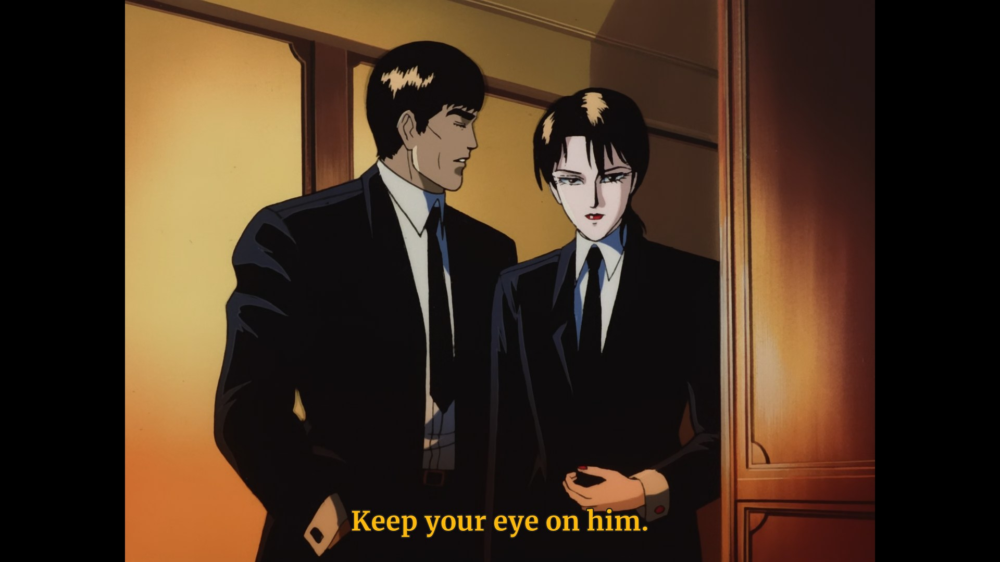

# mpv config

[![release badge]][release]

A personal mpv setup meant to look right on any screen — SDR or HDR, standard or high DPI — and for any viewer: clean scaling, subtitles in the amber tone of classic cinema/TV, stereo-normalised audio and a few small quality-of-life scripts.



## What's inside

**Video** — starts windowed, capped at 90 % of the screen, borderless with rounded corners. The `high-quality` profile is on by default: EWA Lanczos scaling with antiringing, sigmoid upscaling, correct downscaling, temporal dither, full-range output and HDR peak computation. Motion interpolation and hardware decoding are off by default; debanding is off too (`b` toggles it).

**Subtitles** — Merriweather Bold (700), bundled in [`fonts/`](fonts/) and loaded from `~~/fonts`, so nothing has to be installed. Styling is forced over every track (including ASS/fansub signs); external subs autoload fuzzily, and margins, MKV preroll, embedded fonts and subtitle blending are enabled, so screenshots include them.

| Property | Value |
| --- | --- |
| Fill | `#FCBE11` (amber) |
| Outline | `#1F1F1F`, 1.5 (thin) |
| Size | 40 |
| Spacing | 0.5 |
| Shadow | `#33000000`, 1 px |

**Audio** — stereo downmix with `dynaudnorm`, pitch correction when changing speed, fuzzy external audio.

**Languages** — subtitles English (SDH tracks share the same `en` tag) and then Spanish; audio English first, Spanish second. Subtitle languages are forwarded to yt-dlp.

**Streaming** — 100 s cache and a desktop Firefox user agent over HTTP/HTTPS, maximum HLS bitrate, GIFs and WebM loop.

**Keys** — `b` deband, `v` video output levels, `s` screenshot (PNG), numpad `+`/`-` subtitle size ±2.

**Scripts** — `autocrop` (black bars, `C` manual), `autodeint` (`Ctrl+d`), `autoload` (queue the folder), `oled-screensaver` (black overlay after 60 s idle).

**Extras** — minimal bottom-bar OSC (`script-opts/osc.conf`) that only shows while hovering, hides 600 ms after the mouse leaves and uses the filename as title.

## Why Merriweather?

Subtitles are read at a glance, over moving footage, often for two hours straight — not typeset in a book:

- **Screen-native serif with a very tall x-height** (~76–77 % of cap height), so lowercase letters stay substantial at subtitle sizes.
- **Low stroke contrast and sturdy serifs**, which survive Windows/ClearType at standard DPI without thin strokes smearing or glowing against dark scenes.
- **Compact, dense texture**: it sits solidly over busy backgrounds and reads instantly, where airier book serifs such as Source Serif 4 or IBM Plex Serif lose their finer details at this size and distance.
- **Bold 700** carries enough weight to work with a *thin* outline instead of the usual fat black border.

For a fuller comparison, see [Source Serif vs Merriweather: Screen Serif Showdown](https://fontfyi.com/blog/source-serif-vs-merriweather/).

## Usage

No fonts need to be installed: Merriweather Bold ships in `fonts/` (SIL OFL, see [`Merriweather-OFL.txt`](Merriweather-OFL.txt)) and the OSD uses the system's default sans-serif.

```console
# Windows
cd $HOME/AppData/Roaming/mpv && git init . && git remote add -t \* -f origin https://github.com/mfascioli/mpv-config && git checkout master

# Linux / macOS
cd ~/.config/mpv && git init . && git remote add -t \* -f origin https://github.com/mfascioli/mpv-config && git checkout master
```

Update with `git -C <config dir> pull`.

See [CHANGELOG.md](CHANGELOG.md) for release notes.

Based on [wopian/mpv-config](https://github.com/wopian/mpv-config).

[release]:https://github.com/mfascioli/mpv-config/releases
[release badge]:https://flat.badgen.net/github/release/mfascioli/mpv-config
