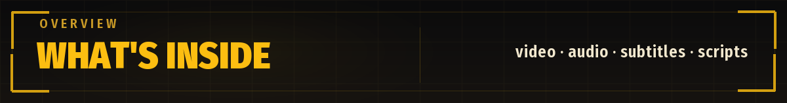
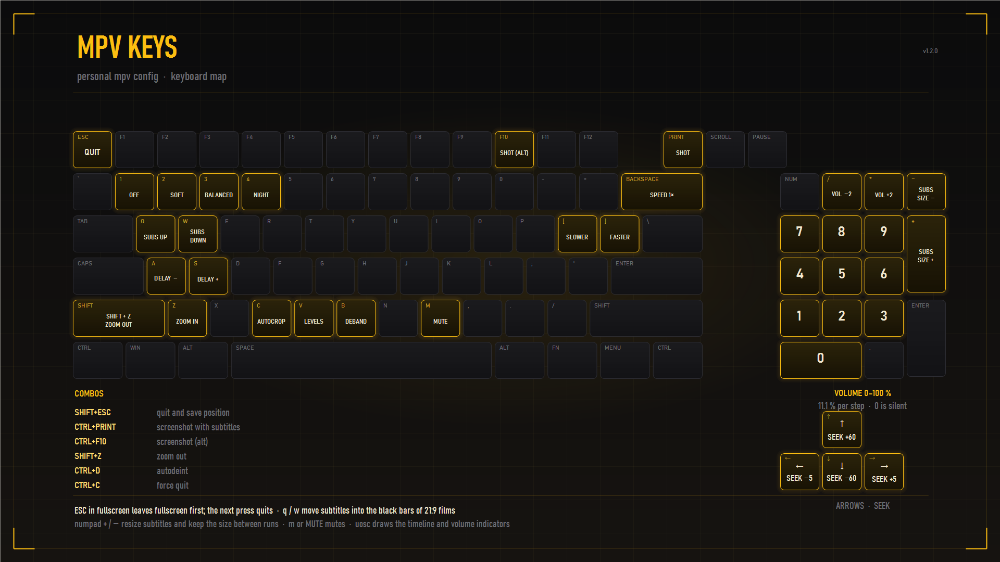
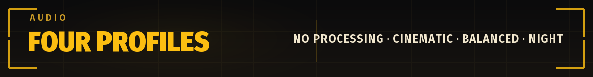
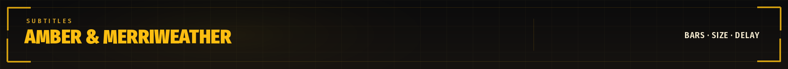
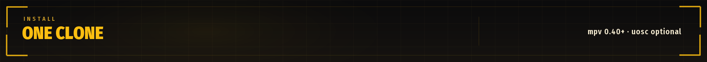
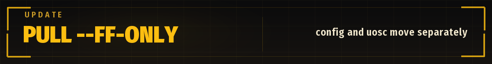
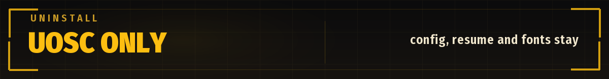
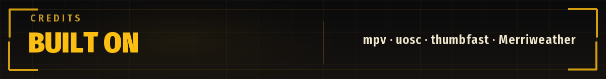
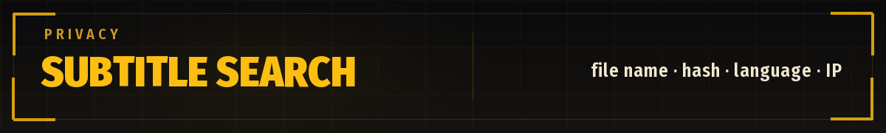

# mpv config

[![release badge]][release] [](README.es.md)


Clean scaling on any screen — SDR, HDR, standard or high DPI — amber subtitles, four audio profiles and a handful of small scripts. Based on [wopian/mpv-config](https://github.com/wopian/mpv-config).


<sub>Wicked City | 1987 — Yoshiaki Kawajiri. Spoiler: it did not go smoothly at all.</sub>

## 🎨 Design


**The colour.** `#FCBE11` is the subtitle yellow I remember from the cinema and from TV at home: warm, familiar, a little nostalgic. On dark scenes it is easier on the eyes than pure white, with less glare over a two-hour film.

**Merriweather Bold.** A screen serif with a tall x-height and low stroke contrast, so lowercase stays solid at subtitle size and survives ClearType. Bold 700 carries a *thin* outline instead of the usual fat black border and keeps its shape over busy footage, where airier serifs such as Source Serif or IBM Plex Serif lose detail. [More on the font](https://fontfyi.com/blog/source-serif-vs-merriweather/).

Subtitle style: fill `#FCBE11` · outline `#1F1F1F` at 1.5 · size 40 · spacing 0.5 · shadow `#33000000` (ARGB, 20 % black) at 1 px.

## What's inside



- **Video** — windowed at most 90 % of the screen, borderless, with the `high-quality` chain below: `gpu-next`, EWA Lanczos, copy-back decoding and no motion interpolation.
- **Subtitles** — Merriweather Bold 700, bundled in [`fonts/`](fonts/) and loaded from `~~/fonts`, so nothing needs installing. Styling is forced over every track (ASS/fansub signs included); external subs autoload fuzzily; margins, MKV preroll and embedded fonts are enabled. They adapt to the window, not the video: `blend-subtitles=no` keeps them on the OSD layer, so they stay sharp at any size and never stretch with the image, and `w` slides them into the black bars of any letterboxed source. Size chosen with numpad `+` / `-` survives restarts.
- **Audio** — stereo downmix, pitch correction when changing speed, fuzzy external audio. Four profiles on `1`–`4`, starting in No Processing; see [Audio profiles](#-audio-profiles).
- **Languages** — subtitles English (SDH shares the `en` tag) then Spanish; audio English then Spanish; forwarded to yt-dlp.
- **Streaming** — 100 s cache, desktop Firefox user agent, maximum HLS bitrate, looping GIF/WebM.
- **Scripts** — `audio-norm` (profiles), `subtitle-size` (persistence), `esc-quit` (two-step close), `autocrop` (crops 10 s after load; `C` toggles), `autodeint` (`Ctrl+d`), `autoload` (queue the folder), `oled-screensaver` (black overlay after 60 s idle), `thumbfast` (timeline previews).
- **Interface** (optional) — [uosc](https://github.com/tomasklaen/uosc) installed from its latest release by the per-system installer ([step 3](#-installation)): proximity timeline, control bar, searchable menus for tracks, OpenSubtitles search ([privacy](#-privacy-uosc-subtitle-search)), playlist, chapters, file browser and keybind lookup, all with thumbfast previews. It follows `osd-font` and the subtitle-language order; the volume slider mirrors the numpad keys (set `volume=none` in `script-opts/uosc.conf` to hide it). Without uosc the minimal OSC in `script-opts/osc.conf` takes over.
- **Thumbnails** — [thumbfast](https://github.com/po5/thumbfast) (MPL-2.0) ships in `scripts/` and renders previews by running mpv from `PATH`. If mpv is not in `PATH` (common on Windows), point to it in `script-opts/thumbfast.conf` (gitignored):

  ```ini
  mpv_path=C:\Program Files\mpv\mpv.exe
  ```

### How video is displayed

`high-quality` is the whole chain. It only resamples when the frame and the window disagree, and these are the defaults for every file.

| Stage | Setting | Effect |
| --- | --- | --- |
| Output | `gpu-next` (0.40+ default), `gpu-context=auto`, Vulkan async compute/transfer, one queue | libplacebo on the GPU |
| Decode | `hwdec=auto-copy` | GPU decode, frames copied back so `idet`/`cropdetect` work |
| Upscale | `scale=ewa_lanczossharp`, `scale-radius=2`, `scale-antiring=1` | sharpened EWA Lanczos, restrained radius, antiringing |
| Downscale | `dscale=ewa_lanczossharp`, `correct-downscaling` | same kernel, low-passed in linear light: no aliasing |
| Chroma | `cscale=ewa_lanczos`, `cscale-antiring=1` | clean 4:2:0 chroma; `ewa_lanczossoft` is `vo=gpu` only |
| Policy | `scaler-resizes-only` | no resampling when the window matches the frame |
| Light | `sigmoid-upscaling` | linear-light upscale: no dark halos or washed highlights |
| Dither | `temporal-dither`, `dither-depth=auto` | rounding follows the panel depth, so gradients do not band |
| Range | `video-output-levels=full` | full-range RGB to the display |
| HDR | `hdr-compute-peak=yes`, `target-colorspace-hint=yes` | tone map on measured peak, report the real colorspace |
| Deband | `deband=no`; `b` toggles | tuned (4 iterations, threshold 48, range 16, grain 48), off |
| Timing | `video-sync=audio`, `opengl-swapinterval=1` | audio is the clock, no interpolation; swap interval 1 on GL contexts |
| Window | `autofit-larger=90%x90%`, `no-border` | at most 90 % of the screen, borderless |

Subtitles are not part of this path: `blend-subtitles=no` draws them on the OSD layer at window resolution. Debanding stays off because it costs GPU time and smears grain, and `b` is the only switch.

## Keybindings



| Key | Action |
| --- | --- |
| `1` / `2` / `3` / `4` | Audio profile: No Processing / Cinematic / Balanced / Night Mode |
| `m` | Mute † |
| `q` / `w` | Subtitles up / down (past 100 % they enter the black bars) |
| `a` / `s` | Subtitle delay −100 ms / +100 ms |
| `Ctrl`+wheel up/down | Zoom in / out (`video-zoom`) |
| `Ctrl`+drag | Pan the zoomed image |
| `F10` / `Shift+F10` | Screenshot without / with subtitles |
| `Esc` | Leave fullscreen; when windowed, quit (a uosc menu closes first) |
| `Shift+Esc` | Quit and save the position |
| `b` | Toggle deband |
| `←` / `→` | Seek −5 s / +5 s † |
| `↑` / `↓` | Seek +60 s / −60 s † |
| `[` / `]` | Speed down / up (×0.91 / ×1.1) † |
| `Backspace` | Speed back to 1× † |
| numpad `0`–`9` | Volume 0 %, 11.1 %, …, 88.9 %, 100 % † |
| numpad `+` / `-` | Subtitle size ±2 (saved between runs) |
| `C` | Autocrop now (it also runs 10 s after playback starts) |
| `Ctrl+d` | Autodeint |

† Flashes uosc's own timeline, volume or speed indicator instead of the built-in OSD bar.

`f`, `Space`, `Alt+Backspace` (reset zoom) and the usual track/playlist keys are mpv defaults. Deliberately unbound: `r`, `t`, `e`, `x`, `z`, `Shift+z`, `v`, `Shift+q`, `5`–`8`, horizontal `9`/`0`, `/`, `*`, wheel up/down/left/right, `S`, `Ctrl+s`, `Alt+s`, `Ctrl+w`, `u`, `V`, `A`, `F`, `G`, `E`, `PrintScreen` and the volume media keys. Only `1`–`4` are horizontal number keys; the numpad digits set volume. `q` no longer quits: `Esc` and `Shift+Esc` are the quit keys (`Ctrl+c` still force-quits).

**Closing** is two-step on purpose. In fullscreen, `Esc` leaves fullscreen and only the next press quits. `Shift+Esc` always quits and saves the position; the window close button also saves (`save-position-on-quit`). Resume keeps the position, not the audio profile — the script reasserts the selected profile on load.

**Screenshots** — `F10` captures the frame, `Shift+F10` adds subtitles. PNG output; with `blend-subtitles=no` neither mode includes the letterbox bars. The old `s`/`S`/`Ctrl+s`/`Alt+s` and `PrintScreen` bindings are gone so `s` can adjust subtitle delay and the print key stays with the system.

**Zoom** — `Ctrl`+wheel moves `video-zoom`: 0 is fit, 0.1 is about +7 %, and negative values zoom out past the frame. `Alt+Backspace` resets zoom, pan and alignment. `z`/`Shift+z` no longer touch the image.

**Autocrop** — after 10 s of playback it detects the encoded black borders and crops them; `C` applies or undoes the crop at any time.

## 🎚 Audio profiles



`scripts/audio-norm.lua` owns the filter chain. Each key **replaces** it, and playback starts in **1 — No Processing**. Bindings call named script bindings, so they can be remapped without touching the Lua.

| Key | Profile | Chain | I (LUFS) | LRA | TP (dBTP) | Character |
| --- | --- | --- | ---: | ---: | ---: | --- |
| `1` | No Processing (default) | none | — | — | — | original mix |
| `2` | Cinematic | `loudnorm` | −23 | 18 | −1 | wide, natural |
| `3` | Balanced | `loudnorm` | −18 | 15 | −2 | controlled |
| `4` | Night Mode | `acompressor` 4:1 at −18 dB → `loudnorm` | −16 | 7 | −3 | dialogue lifted |

Cinematic, Balanced and Night Mode use `loudnorm` in single-pass dynamic mode (`linear=false`): gain follows the target live, no pre-scan. Night Mode adds one compressor stage — threshold `0.125` (≈ −18 dBFS), ratio `4:1`, attack `20 ms`, release `250 ms`, knee `2.5`, unity makeup. Every processed profile ends in `alimiter` (`level=0`, 5 ms attack / 50 ms release): `loudnorm`'s TP is the true-peak target, `alimiter` the sample-peak safety net.

- **LUFS** — perceived loudness; `loudnorm` drives gain to the target and constrains LRA and TP.
- **Loudness ≠ volume** — loudness belongs to the recording; volume to the player, OS, DAC or speakers.
- **Dynamic normalization** — adjusts as it plays; no pre-scan, so results depend on the source.
- **Compression** — `acompressor` turns down what exceeds its threshold, shrinking the gap between dialogue and effects.
- **LRA** — the quiet-to-loud span; a lower target compresses it more. Labels describe the intended result, not a measurement of every soundtrack.

**Volume** starts at 100. Numpad `0`–`9` sets 0 %, 11.1 %, …, 88.9 %, 100 % (0 is silent, 9 is full scale); `/` and `*` adjust ±2; `m` and the mute key mute. `volume-max=100` blocks gain above 100 %, and the horizontal `9`/`0`, `/`, `*`, the plain wheel and the media volume keys stay unbound (`Ctrl`+wheel is zoom).

**Resume** restores position only: `watch-later-options-remove` drops `af`, `volume` and `mute` from new watch-later files, and the profile is reasserted on every load. Old watch-later files may still carry a volume; deleting them clears it.

## 💬 Subtitles: adaptive placement



Subtitles are laid out against the window instead of the video image: `blend-subtitles=no` keeps them on the OSD layer, so they stay sharp at any window size and never stretch with the picture. `sub-use-margins=yes` and `sub-ass-force-margins=yes` let them use the whole frame, and `w` moves them into the bottom black bar of any letterboxed source — 21:9 or 4:3, same behaviour. `sub-pos` runs 0–150; 100 is the normal spot just above the bottom edge, and `w` (or ~100–106) sits inside the bar. Much higher approaches the window edge and can clip, especially with two lines.

Numpad `+` / `-` change the size; `scripts/subtitle-size.lua` writes every change to `subtitle-size.txt` and restores it at startup. The file is gitignored — delete it to fall back to `sub-font-size=40`.

## 📥 Installation



Requires **mpv 0.40+** (`gpu-next`; tested on 0.41 and 0.42). The repository *is* the config folder, so installing is one clone. **Already using this config?** Do not clone again — go to [Updating](#-updating).

**1 — Clone.** Pick your system; the rename keeps an old config as `mpv.backup` and does nothing when there is none. Git is the only tool needed — on Windows, install [git-scm.com](https://git-scm.com/downloads) first.

Windows (PowerShell):

```console
if (Test-Path "$env:APPDATA\mpv") { Move-Item "$env:APPDATA\mpv" "$env:APPDATA\mpv.backup" }
git clone https://github.com/mfascioli/mpv-config.git "$env:APPDATA\mpv"
```

Linux / macOS:

```console
mv ~/.config/mpv ~/.config/mpv.backup 2>/dev/null
git clone https://github.com/mfascioli/mpv-config.git ~/.config/mpv
```

**2 — Start mpv.** Settings, keybindings, scripts, the Merriweather font and a minimal OSC are ready. mpv finds the folder by itself — no flags, no network.

**3 — Optional: uosc.** The timeline, control bar, menus and search. Run one command; skip it to keep the minimal OSC:

```console
powershell -ExecutionPolicy Bypass -File "$env:APPDATA\mpv\install-uosc.ps1"   # Windows 10/11
bash ~/.config/mpv/install-uosc-ubuntu.sh                                      # Ubuntu / Debian
bash ~/.config/mpv/install-uosc-cachyos.sh                                     # CachyOS / Arch
bash ~/.config/mpv/install-uosc-macos.sh                                       # macOS
```

The installer is native to each system, fetches the latest uosc release over HTTPS, verifies GitHub's SHA-256 and keeps an existing `script-opts/uosc.conf`. Linux needs `curl`/`wget` plus `unzip`/`bsdtar` and asks before installing a missing package (`--yes` / `-y` skips the question); `--no-verify` skips the checksum. Everything it installs is gitignored, so updates never overwrite uosc, and each Linux installer refuses to run on the wrong distro. Config folder somewhere else? Append `-ConfigDir <path>` / `--config-dir <path>`.

### 🔄 Updating



Two independent pieces — update them separately.

**The config.** One command, no need to open the folder:

```console
git -C "$env:APPDATA\mpv" pull --ff-only   # Windows
git -C ~/.config/mpv pull --ff-only        # Linux / macOS
```

Files you added and the gitignored `script-opts/*.conf` are left alone. Your own edits to tracked files block the pull: move them aside or `git stash` first.

**uosc.** Rerun its installer, the same command as step 3. It replaces uosc only and keeps `uosc.conf`.

uosc's **Utils → Update uosc** also works, but pipes the latest `master` installer into a shell (`irm … | iex`, `source <(curl …)`); the installer above downloads a release and validates its layout first.

### 🗑 Uninstalling uosc



```console
powershell -ExecutionPolicy Bypass -File "$env:APPDATA\mpv\uninstall-uosc.ps1"   # Windows
bash ~/.config/mpv/uninstall-uosc.sh                                            # Linux / macOS
```

Removes `scripts/uosc/`, the two `fonts/uosc_*` files and `script-opts/uosc.conf`, leaving the rest intact; `-KeepConf` / `--keep-conf` keeps your preferences. The built-in OSC takes over immediately. To remove the config itself, delete its folder — your old files are still in `mpv.backup`.

See [CHANGELOG.md](CHANGELOG.md) for release notes.

## Credits



Interface by [uosc](https://github.com/tomasklaen/uosc) (LGPL-2.1); thumbnails by [thumbfast](https://github.com/po5/thumbfast) (MPL-2.0); Merriweather under the SIL OFL (see [`Merriweather-OFL.txt`](Merriweather-OFL.txt)).

## 🔒 Privacy: uosc subtitle search



The subtitle search inside uosc is a third-party call, not a local feature. A search sends **OpenSubtitles** the video file name without its extension, the file hash when available, the languages and page you asked for, and your IP address; downloading a subtitle also sends its id. The requests come from `ziggy`, the helper binary bundled with uosc.

I checked the published source — `menus.lua` and `main.lua` for the search UI, `subtitles.go`, `utils.go` and `http.go` in `ziggy` — and found no analytics, tracking pixels or ad telemetry in this feature.

That audit covers published code, not live traffic: it cannot show what OpenSubtitles does with the data, or rule out changes in a later release. A file name still says what you are watching. If that matters to you, skip the built-in downloader and fetch subtitles elsewhere — the rest of uosc works without it.

The wider review — provenance, installer guarantees, what was fixed and what it cannot prove — is in [SECURITY.md](SECURITY.md).

[release]:https://github.com/mfascioli/mpv-config/releases
[release badge]:https://flat.badgen.net/github/release/mfascioli/mpv-config
